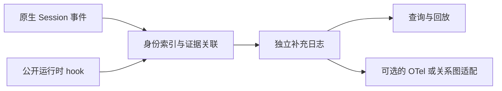

# DSH 日志增强：项目设计

整理日期：2026-11-06。本文记录总体设计；首版已实现的范围和记录协议见 [使用说明](runtime.md)。
当前接口依据见 [上游契约](upstream-audit.md)，迁入经验见 [研究交接](research-handoff.md)。

## 1. 定位与已确定的方向

项目名为 **dsh-log-enhance**，中文名为 **DSH 日志增强**。

目标是为 DeepSeek Harness 原生日志补充结构化语义、事件关联与运行时观测信息。
原生日志继续提供执行事实；插件保存可验证的补充证据，并给这些事实建立明确的关系。
用户应能从一次调用追到它产生的消息，也能从一条消息反查来源及后续进入的执行阶段。

范围可以逐步覆盖：

- 操作语义：Agent 执行、工具调用、委派、消息传递和任务变更。
- 关联语义：调用到消息、任务到执行、父子 Agent、会话来源与恢复。
- 生命周期语义：请求、接受、领取、进入上下文、取消、结束等独立事实。
- 消费方式：结构化查询、回放、协作关系分析，以及可选的可观测平台适配。

DSH 的日志已经包含大量结构化信息；实施前应证明一个候选增强确实补充了缺失事实或关系。
首个闭环选择 `send_message` 调用与收件方消息之间的精确关联。

## 2. 三类增强与证据边界

| 数据现状 | 插件职责 | 保证边界 |
|---|---|---|
| 原生日志已有明确身份，但缺少易用关系 | 建索引、关联事件、形成派生记录 | 保存来源引用和规则版本，支持重新计算 |
| 运行时知道，默认日志未保留 | 监听公开 hook，保存补充观察 | 只覆盖插件实际观察并成功保存的部分 |
| 日志和公开运行时接口都未暴露 | 标记未知，提出上游字段或事件需求 | 不用推测填成确定事实 |

观察事实与派生关系应可区分。例如“收到带有 m42 的成功回执”和“B 入箱 m42”是输入证据，
“A 的某次调用产生 B 的 m42”是按明确 ID 连接得到的关系。展示关系时应能查看其依据。

## 3. 首版闭环：call-123 → m42

### 当前可用的数据

1. A 的原生 `tool/call` 记录包含 `turn`、`step`、`callId` 和工具名，并有 Session 内的 `seq`。
2. 当前 `send_message` 返回接收方实际入箱消息的 `{ messageId }`。
3. 运行时 `tools/result` 提供调用上下文与成功的 `result.value`。
4. B 的 `agent/inbox/spliced` 插入记录包含消息 ID 和 `source.senderSessionId`。
5. 默认持久化 `tool/result` 不保存执行局部的 `value`；当前该工具的正文与 `meta` 也不保留消息 ID。

因此，可以通过成功回执和接收方入箱事实建立准确关联。插件必须同时检查消息 ID、
消息 source 类型和发送 Session；接收方以实际入箱事件所属的 Session 为准，不只保存可变名称。

### 建议的数据流



两侧到达顺序不应影响结果。以单次执行身份保存待匹配回执，以实际入箱 occurrence 保存接收证据；
只有证据齐备才产生确定关联。重复观察应可幂等处理，超时或容量淘汰要留下可诊断的覆盖缺口。

### 补充记录示意

以下是关联结果的概念结构。首版将接受事实与运行时回执分别落盘，查询时生成关联；实际 v1 记录
结构见使用说明。事件序号仅为示例；`formatVersion: 4` 对应检查基线。

```json
{
  "schemaVersion": 1,
  "type": "dsh.message.linked",
  "source": {
    "sessionId": "A",
    "formatVersion": 4,
    "callEventSeq": 128,
    "turn": 7,
    "step": 2,
    "callId": "call-123"
  },
  "target": {
    "sessionId": "B",
    "formatVersion": 4,
    "inboxEventSeq": 63,
    "messageId": "m42"
  },
  "evidence": {
    "method": "exact-id-join",
    "runtimeHook": "tools/result",
    "ruleVersion": "send-message-link/v1"
  }
}
```

首版记录包含稳定事件 ID、生产者版本、观测时间和覆盖缺口，关联输出保留所用证据 ID。
原始事件引用使用 Session、格式版本和事件序号；同一消息重新入箱时，还需区分具体入箱 occurrence。
不能只用 `callId`、工具名或消息文本作为全局键，也不能普遍假设一次调用只对应一条消息。

运行时 `tools/result` 可以早于 A 的持久化 `tool/result` 出现，不能编造后者的事件序号。
成功回执也不包含接收 Session ID，需通过实际入箱证据补齐。

### Native 与嵌套工具

先验证 Native 工具调用的完整路径。PTC 嵌套调用有自己的执行身份、`rootCallId` 和 dispatch 记录，
不能全部归到外层 `run_code`。首版如未支持嵌套调用，应显式报告覆盖范围和未解析来源；
在完成对应契约核查与测试前，不对外宣称覆盖所有 `send_message`。
绕过工具、直接调用 service 的消息同样需要独立来源契约。

## 4. 消息进展的语义

| 阶段 | 证据 | 可以表达的含义 |
|---|---|---|
| accepted | 接收方自己的 inbox 插入事件 | 已被接收到待处理队列，未必已完成磁盘 flush |
| claimed | live `agent/inbox/claimed` | 某 turn 领取了该输入，pre-step 仍可能拒绝或改写 |
| admitted | 相同消息身份的 append-form `user/message` | 输入进入会话 surface；对具体模型请求的归属仍需检查请求构建和变换 |
| canceled / replaced | 取消 splice、discarded 和明确替换事实 | 相应 pending occurrence 被移除或替换 |
| execution ended | 对应执行的结束记录 | 执行结束；不直接证明消息要求或业务任务完成 |

“进入模型请求上下文”必须有实际请求或可重建请求的依据。领取、提交到 surface、发起请求、
模型遵从是不同事实。pre-step 改写消息 ID 时，只有显式保留的映射才能连接新旧消息。
读取不完整 inbox suffix 时，不能仅凭移除数量恢复被移除消息身份。

## 5. 存储与恢复

首版采用插件拥有的独立 JSONL 补充日志，原始事件通过引用连接。每次激活写入独立文件；
查询统一读取目录，以证据 ID 去重并重新构建关联，无需在线保存未完成的跨消息 join。
在线索引负责将运行时回执绑定到原始调用，以及跟踪消息 occurrence；它有容量和过期边界。

原因是当前 `appendPluginRecord` 明确限制第三方插件使用；普通自定义 Session 事件还涉及
未知类型恢复和持久化格式兼容。不能仅凭 TypeScript declaration merging 就承诺可安全重载。
直接写入主日志需要上游提供正式支持的扩展路径，详见 [上游契约](upstream-audit.md)。

实现需要满足：

- 区分观察到、进入插件队列、补充日志持久化、导出成功；分别暴露相应状态。
- 事件关系可去重，重放不增加事实计数；跨格式迁移不能默认旧序号仍可直接解析。
- fork 继承前缀与子 Session 自有事件分开；恢复历史不重新解释为 live 行为。
- 补充记录本身可重放；仅有旧原生日志时，未保存的运行时回执仍然无法恢复。
- 明确处理索引、未完成关联、队列的容量边界，以及损坏尾部、重启、HMR、卸载。
- 热路径只做受控工作；慢存储或远端网络不得拖住 DSH 原生持久化检查点。
- 默认只保存身份、状态和证据引用；关联不需要复制提示词、消息正文、任务描述或工具输出。
- 旁路观察和独立存储不自动继承官方遥测的脱敏、反馈授权或禁用策略。

## 6. 纯插件的可靠性上限与上游需求

存在无法只靠成功回执覆盖的窗口：B 已接受 m42，随后进程崩溃，或发送端取消/错误使最终
成功回执没有抵达插件。B 的入箱事实仍成立，精确来源可能未知。独立补充日志与 DSH 主日志
之间也没有天然的跨存储原子提交保证。

更完整的方案是由运行时在接收方提交消息前携带真实来源：

```text
message.source:
  senderSessionId
  origin:
    tool: 精确调用身份（包含必要的 turn/step/callId 或事件引用）
    host/service: 明确的非工具来源
```

这属于上游扩展提议。来源应由执行上下文注入，而非由模型参数填写，并随实际接收消息保存、
恢复。它解决来源追溯，不能单独提供跨 Session 原子落盘、消息 exactly-once 或重试去重。
旧消息缺少来源时保留未知。

## 7. 首版验收标准

下表定义行为验收要求。首版已经执行的验证与尚未覆盖的情形在使用说明中分别列出。

| 场景 | 应证明的行为 |
|---|---|
| A 并发发送相同文本给 B | 按 ID 区分调用与消息，不串线 |
| 不同发送者、多接收者、一个 step 领取多条消息 | 保留各自来源，不强选单一父调用 |
| 入箱事件先到或回执先到，结果迟到 | 关系一致，迟到结果仍归原始调用 |
| 重复通知、插件恢复、补充日志回放 | 不重复创建同一 occurrence 的关系 |
| B 已接受，但 A 最终失败或回执缺失 | 保留接受事实，来源未知；不反推投递失败 |
| 进程在接受与补充日志保存之间退出 | 明确暴露可能的覆盖缺口，不承诺全量因果审计 |
| claim 后 pre-step 拒绝或改写 | 不伪造 admission、请求发送或任务完成 |
| pending 取消、替换、不完整历史 | 区分 occurrence；没有证据不猜被移除消息 |
| fork / cold resume / HMR | 历史、继承、现场观察分别处理；不重复算作新投递 |
| 存储失败、队列满、关闭时仍在写入 | Agent 行为保持不变；丢弃可诊断，关闭遵守总预算 |
| 嵌套调用或直接 service 发送未覆盖 | 输出明确覆盖状态，不冒充 Native 调用来源 |
| 启用和禁用插件分别运行同一确定性任务 | 模型请求、工具结果和执行语义一致 |

实现验证应经过真实 Loader/AgentLoop 与确定性 adapter/tool，并实际读回补充记录。
仅成功 import、配置出现插件 row 或文件非空，均不足以证明闭环成立。

## 8. 后续扩展与尚待决定的问题

后续候选包括任务变更 actor/action、任务到执行的绑定、子 Agent 创建来源、恢复与 fork 关系、
外部产品 run/session/artifact 的显式引用。每项先查现有契约，再决定是派生索引、运行时采集
还是上游扩展。任务 owner 不能代替 actor，状态区间不能直接换算活跃耗时或 token 成本。

OTel 可作为消费层：GenAI 属性描述操作，Span Link 表达有证据的跨执行关系。
标准不自动产生缺失来源；后端还必须真正保留和展示 Links。核心日志模型不要求先生成 span。

当前实现选择固定 Harness 基线、Native 调用、v1 JSONL 证据与离线 CLI 查询。
PTC 精确来源、跨恢复的未完成运行时身份、更多任务和外部 Agent 语义仍需专门契约和测试。
